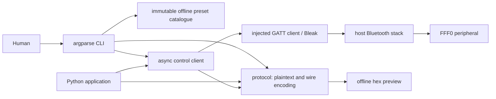
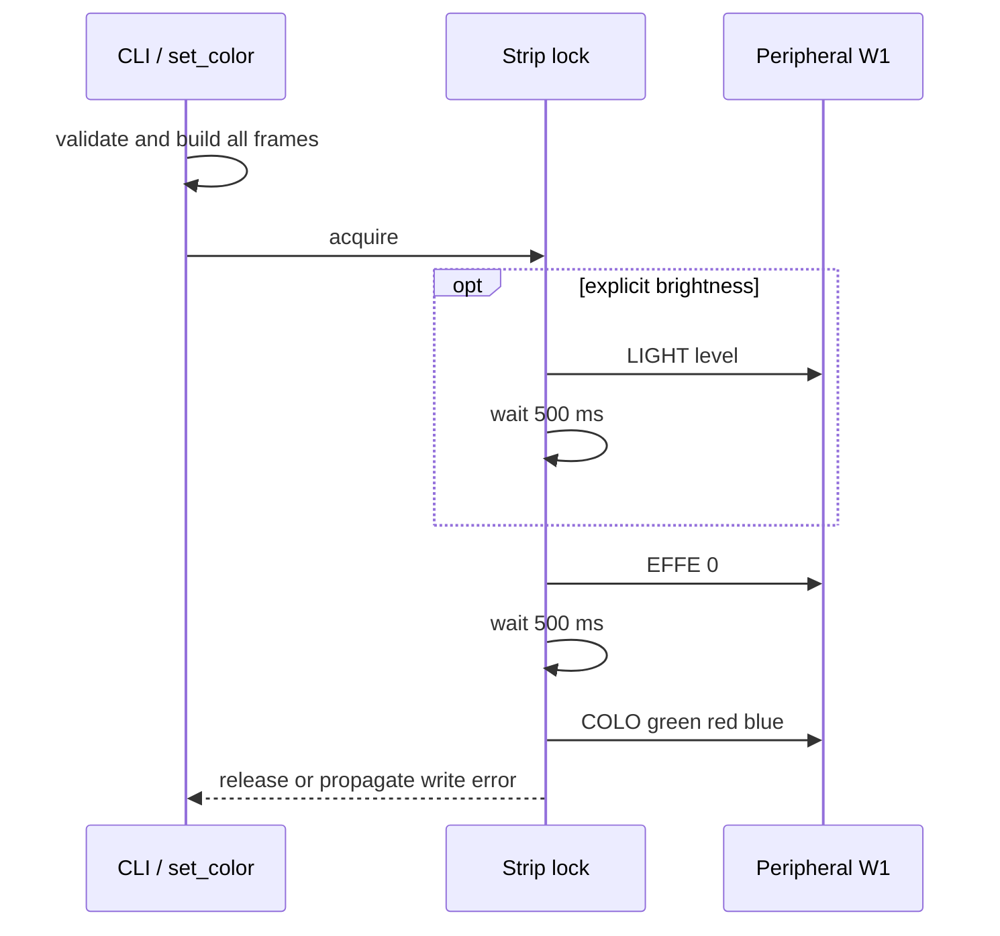
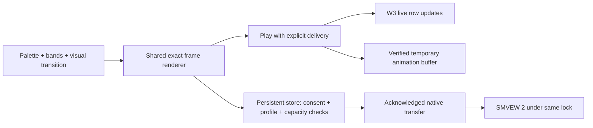

# Library design · TASK-001

One local process controls one explicitly selected peripheral. No daemon, accounts, retained pairing data, or cloud service. The Android archive is an analysis input only. Protocol source: [wire specification](../protocol.md). Component inventory: [third parties](../dependencies/third-party-components.md).



```mermaid
sequenceDiagram
  participant U as CLI / API caller
  participant B as Bleak + OS
  participant P as Peripheral
  U->>B: find selected identifier; connect
  B->>P: discover services
  U->>B: resolve W1 in FFF0, check properties
  U->>B: write one encrypted block
  B->>P: characteristic write
  B-->>U: transport completion or error
  U->>B: disconnect (including on exception)
```

**SWR-001-AC1:** pure deterministic frame builder and inverse block codec; reject invalid lengths/ranges. **SWR-002-AC1:** CLI dry run requires neither Bleak nor a radio; live writes only to the selected device and discovered characteristic. **SWR-003-AC1:** expose separate optional BLE I/O; fake transport verifies payload, target and write mode. CLI deliberately covers ordinary strip commands; advanced frame builders available via Python. Bulk media rendering is a separate app feature. One application owns its connection context; serialize dependent commands and observe actual notifications before advancing transfer state. Offline inputs are immutable bytes; no persistent device state. Compatibility lifecycle: add new app/firmware profiles alongside this baseline, keep protocol vectors, rerun physical checks for the new model. Diagram source included; rendering NOT-RUN.

## 0.2 hardware integration · TASK-002

User source: integrate the capabilities and findings confirmed in the
[physical session](../hardware-session-2026-11-21.md). **SWR-004-AC1:** CLI and
high-level methods share pure scene builders; static RGB plans [LIGHT,] EFFE 0,
COLO. Preserve raw single-frame API semantics. Prevalidate all frame bytes and
delay before I/O, hold the per-Strip lock across the entire scene, stop on the
first failure and propagate it. This prevents local interleaving, not remote
actors or changes made by another Strip instance. No rollback is possible
without reliable state readback; cancellation can leave partial changes.

**SWR-004-AC2:** presets are immutable, local app metadata. IDs 1–25 for ANIM
and IMAG, 0–5 for EFFE; low-level `plaintext` still accepts raw octets. Observation
provenance identifies a particular model, not universal support. Catalogue
listing must work without the radio and must not imply a storage directory.
Version reads reuse the existing direct-read characteristic, not an invented
inventory request. Single-frame selector calls neither upload nor save.

`protocol.py` owns scene order, `catalogue.py` owns catalogue constants, `client.py`
owns sequencing and locking, `cli.py` owns argument parsing and displaying the
same planned frames. `led.ps1` resolves paths relative to itself and starts the
source CLI via the venv or the existing portable interpreter; no persistent
PATH/registry/interpreter changes. Optional Bleak dependency remains unchanged.



500 ms is the tested inter-command gap, not an established minimum. The new
CLI's color behavior intentionally changes from single-frame COLO; pure `color()`
does not. No image rasterizer, OTA, unknown opcode probing or content readback
is added. Firmware quirks and unsupported targets remain documented rather
than hidden behind speculative caching or retries.

## 0.3 topology and live frames · TASK-003

Sources: [calibration and user acceptance](../topology-live-frames.md),
[API contract](../live-frames.md). **SWR-005-AC1:** derive logical dimensions
from an actual STYPE notification plus the app's known profile table, retaining
the raw type. No fallback grid, fabricated discovery query or claimed physical
length. Waits are bounded; unknown profiles and absent replies fail. Dimensions
are separate from human-calibrated mounting orientation.

**SWR-005-AC2:** accept 1–256 2D RGB frames (triples or packed colors), validate
and copy all before scene-changing writes, bound total normalized pixels to
1,000,000. `frames.py` owns immutable topology/mapping/normalization/results.
Apply transpose then native-axis flips; default frame[y][x] maps to W3 (y,x)
for the tested top-left 20×26 mounting. No serial serpentine mapping is invented.

**SWR-005-AC3:** playback serializes initialization and all pixel writes on the
Strip lock. Optional brightness, effect-disable, black and enter-edit commands
precede a full first frame; differences follow without a cross-run pixel cache.
Do not save or upload. Pace each changed pixel and enforce a requested FPS
ceiling using each frame's actual submission time. An overrun slips instead of
triggering catch-up bursts. Return host-submission counts and elapsed time,
never renderer acknowledgements. Cancellation/error leaves a complete/partial
unsaved image and releases the lock; no rollback/save/retry in cleanup.

`client.notifications` now owns one native subscription set shared by its
consumers, with last-consumer cleanup and partial-setup rollback. It caches
only actual topology reports per connection, not current RGB/brightness/effect.
Receive callbacks are synchronous and exception-isolated through the event
loop's exception handler. A separate notification lock protects subscription
lifecycle; the existing write lock serializes scene/frame outputs. The CLI's
JSON loader is bounded to 4 MiB; offline frame previews derive dimensions from
input and explicitly do not claim controller discovery. `examples/moving_dot.py`
generates stdlib-only synthetic input and refuses to overwrite an existing file.

```mermaid
sequenceDiagram
  participant U as play_frames caller
  participant S as Strip
  participant P as Controller
  U->>S: frames + optional mapping
  opt topology not provided or cached
    S->>P: enable notifications (CCCD)
    P-->>S: encrypted STYPE report
    S->>S: parse app-profile dimensions
  end
  S->>S: validate/copy all frames before lighting writes
  S->>S: acquire write lock
  S->>P: optional LIGHT, EFFE 0, COLO black, SMVEW 1
  loop full first frame, then differences
    S->>P: encrypted W3 pixel(y,x,GRB)
    S->>S: pace writes and hold requested frame interval
  end
  S-->>U: release lock; submission stats (no save)
```

Runtime/performance trade-off: W3 is a pixel interface, not an atomic frame
transport. At 520 pixels and 10 ms gaps, a full refresh takes at least 5.2 s
plus overhead; deltas make sparse effects practical. No bulk bitmap/upload
protocol is silently substituted because that could affect persistent content.
No added dependency, cloud service, daemon or filesystem cache. Other model
profiles, mounting transforms on hardware and faster pacing remain unverified.

## 0.4 pre-made live effect collection · TASK-004

Source: user-requested **XMAS 01** and **XMAS 02**, documented in
[collection semantics](../effects.md). **SWR-006-AC1:** immutable named effect
definitions render full-height vertical two-string color bands, red/green or
red/white, then rotate the actual finite-width image right by one column per
phase. On 20 columns the shortest cycle has four phases; partial-band widths
must wrap the finite image rather than invent new colors at the edge.

**SWR-006-AC2:** `Strip.play_effect` uses the existing validated player and
topology/mapping, requesting a two-second interval (0.5 FPS). It must neither
save/upload effects nor add two seconds after write completion. Frames overrun
instead of catching up in bursts; host results expose `overrun_frames` and
`max_frame_write_seconds` (including initial full draw and per-pixel pacing).
Two-second **visible** transition acceptance remains pending hardware evidence.
Names are local library metadata, not peripheral slot IDs or app catalogue
entries. CLI `effects` is offline; `run-effect` reads live geometry or requires
explicit offline dimensions. No export file is needed to play a known name.

`effects.py` owns `StripedEffect`, constants and immutable collection lookup;
`client.py` delegates rendering/streaming to `play_frames`. Bounded runs remain
the default. Explicit `repeat=None` / CLI `--forever` holds the write lock until
cancellation, retaining delta state across cycles and avoiding repeated clears.
Cancellation still leaves an unsaved complete/partial image without rollback.

Timing trade-off: ten of twenty strings change per phase, requiring 260 W3
writes. The generic 10 ms gap is already 2.6 s before transport overhead. The
named helper therefore requests no **extra** pixel gap by default; awaited BLE
operations and event-loop yields remain. This faster policy is documented,
overrideable and not physically certified. It does not modify the conservative
`play_frames` default. No new dependency or protocol/opcode was introduced.

0.4.1 user-directed default change: named collection playback now defaults to
`repeat=None` / continuous streaming; `repeat=N` remains an explicit bounded
override. CLI `--forever` is retained for compatibility. Generic frame-array
playback remains single-run by default. This changes neither the write-lock /
cancellation contract nor the known visible transition failures.

## 0.5 buffered native animation delivery · TASK-005

User clarified XMAS 03/04 retain paired strings but must avoid downward
repainting. The owner explicitly authorized a bounded custom-animation upload,
accepting replacement risk; firmware/reset operations remain excluded.
[Buffer investigation](../buffered-animation-investigation.md) records the
source trace, exact approved bytes, ACKs and corrected power-cycle evidence.

**SWR-007-AC1:** reuse pure array normalization/mapping, then serialize frames
in **column-major GRB** order matching `DiyFragment.getSendData` and
`DataUtils.colorConvertBRGArray`. Build the MANY count/raw-speed/length header
and indexed W2 chunks offline. Validate frame, byte, chunk-index and actual GATT
value bounds before changing custom content. No arbitrary-MTU packet format,
index wrapping, gamma/alpha guessing or vendor assets.

**SWR-007-AC2:** require `allow_overwrite is True` on high-level upload paths,
including `play_effect` for native 03/04. CLI rejects missing consent before
connecting. One per-Strip lock owns subscription/optional brightness/MANY,
stop-and-wait REOK chunk flow, and MANCP. Arm each ACK future before its write;
enforce per-write+reply and total setup/transfer deadlines. Device ERROR,
unexpected transfer reply, timeout, cancellation or transport exception stops
locally without retry, guessed abort, finish-after-failure or rollback. Existing
native subscriptions are shared; cleanup preserves other listeners. These
guards prevent accidental high-level uploads, not expert raw `send` operations.

`buffered.py` owns immutable plans/results and encoding; `client.py` owns
consented transfer/state/locking; `effects.py` declares explicit live/buffered
delivery. Live 01/02 remain unchanged. `upload_effect` can deliberately buffer
any named pattern, while `run-effect` uses the definition's normal transport.
MANY has no destination slot/name: do not claim multiple installed names or
an inventory. `AnimationUploadResult` means MANCPOK, not persistence proof.

```mermaid
sequenceDiagram
  participant U as Consenting caller
  participant S as Strip / transfer lock
  participant P as Controller FFF0
  U->>S: upload frames (allow_overwrite=True)
  S->>S: normalize/serialize/preflight all bounds
  S->>P: subscribe before header
  S->>P: optional LIGHT, then encrypted MANY
  P-->>S: MANYOK
  loop each indexed chunk
    S->>P: W2 unencrypted indexed bytes
    P-->>S: encrypted REOK
  end
  S->>P: encrypted MANCP
  P-->>S: MANCPOK
  S-->>U: transfer result; connection may close
  P->>P: autonomous whole-frame playback
```

Hardware finding: on the tested device, native speed 10 yielded approximately
two-second clean whole-string changes and continued after disconnect. Another
effect resumed after actual power cycling. That establishes no automatic
startup resumption, **not** whether bytes were erased or merely unselected.
No verified persistence/reselect command was found or guessed. Native host
repeat counts are unknown, so only autonomous continuous operation is offered;
the API/CLI returns after transfer rather than streaming forever. XMAS 04's
physical white appearance is still unverified. No new dependency/service.

## 0.6 independent visual transitions and persistent storage · TASK-006

Source: user requested simultaneous top-to-bottom updates in XMAS 01/02 and
effect-independent storage/overwrite. The user explicitly chose full LED-row
resolution, accepting a capacity error rather than a hidden coarse stored
variant; authorized save/isolation experiments are in the investigation record.

**SWR-008-AC1:** `StripedEffect` owns palette, bands, target duration and visual
`transition`, not a transport/storage flag. `phase_frames` gives base pictures;
`frames` renders either cuts or synchronized row-front composites. The same
rendering goes to every delivery/storage path. At 20×26 the wipe cycle has 104
snapshots; all affected columns at row y change before row y+1, including the
loop boundary. Target interval is 2/26 s; initial reliable draw is separately paced.

**SWR-008-AC2:** delivery is a `play_effect` argument. Auto prefers live for wipes
and buffered for cuts; neither requests persistent save. The profile-matched
temporary-buffer isolation test permits normal buffered play without a persistent
overwrite flag. Unknown firmware/model combinations reject verified safe buffered
play and storage before content writes. Capability booleans indicate verified
library support, not inferred hardware absence on other models.

**SWR-008-AC3:** only separate `store_effect` / `store_animation` operations
persist, requiring `overwrite=True` because no inventory/free-slot/readback path
exists. On verified TR2103R001-8 + STYPE26X20 they call the common acknowledged
transfer, then wait 1 s, write SMVEW 2 (prefer ATT response where available), and
wait 6 s. One write lock covers upload through commit/settle, so another local
operation cannot replace the buffer after MANCPOK but before save. Failed uploads
never save; cancellation/save errors may leave changed state and never retry or
rollback. Results distinguish host write completion from a fresh physical cycle.

Preflight capacity checks are numerical and name-independent: a full wipe is
162240 bytes and cannot fit the 16-bit byte length or the stricter verified chunk
limit. Storage fails before any content/brightness/save writes; it never reduces
resolution. Four-frame cuts fit. Speed is a separate firmware limitation: saved
animation/startup selection resumed, saved speed did not. No guessed speed-save,
unknown persistence commands, firmware/reset actions, dependencies or services.


